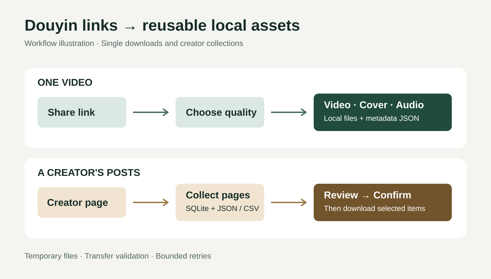

# douyin-video-downloader

English | [中文](./README.zh.md)

## Overview

An Agent Skill for creators and content researchers who want to save Douyin videos, covers, direct music audio, and creator post lists as reusable local files. It includes a Node.js CLI and SQLite collection workflows, so an Agent can inspect a link, save selected media, or collect a creator's posts before asking which items to download.

## Preview



## Features

| Capability | What it helps you do |
|---|---|
| Single-video downloads | Save MP4 video with a chosen quality and an optional cover. |
| Creator-page collection | Traverse post pages, save metadata in SQLite, and export JSON or CSV. |
| Confirmed batch downloads | Download selected videos, covers or direct audio from a collection. |
| Cover and direct audio | Save a cover separately or download the music URL supplied by Douyin; no audio extraction from video. |
| Transfer validation and retries | Check complete HTTP transfer, non-empty output and advertised length; retry transient failures while protecting existing files. |

## Installation

### Requirements

Use an Agent client to install and invoke the Skill. Single-link tasks need Node.js and network access; collection integrations can be prepared when requested.

| Item | Requirement |
|---|---|
| Agent client | Codex or Claude Code; Codex has been exercised, Claude Code has not been runtime-tested here. |
| Runtime | Node.js 18 or newer. |
| Network | Access to Douyin pages and media endpoints. |
| Collection database | The SQLite command-line tool for database operations. |
| Browser collection | A compatible Playwright CLI wrapper and a valid local login when required. |

macOS has been tested locally. Windows paths and command launching have been reviewed, but native Windows execution has not been tested in this environment. Browser collection requires a platform-compatible wrapper. See [runtime requirements](./docs/runtime-requirements.md) for setup details.

### Quick Installation

Ask your Agent:

```text
Install https://github.com/chemny/douyin-video-downloader. Check and prepare the core runtime, then verify that the Skill is installed and can be loaded. Prepare browser collection tools only when I request collection.
```

The Agent should report the installed location, entry-point readiness and any missing tools or permissions.

## Quick Start

Give your Agent a Douyin share link:

```text
Download this Douyin video and its cover, and tell me where the files were saved: {Douyin link}
```

The download produces local media and a metadata JSON file. If quality choices matter, ask to inspect the link before downloading.

## Usage Examples

### Collect a creator's posts before downloading

```text
Collect up to 100 posts from this Douyin creator page and export a CSV. Do not download the videos yet: {creator page URL}
```

Collection reuses a local login where possible, follows pages in cursor order and saves each page. The default cap is 100 posts; `--limit 0` removes the item cap with a 1,000-page safety cap. Collection stops on invalid or stalled pagination and exports saved results after a later-page failure.

### Download selected items from a collection

```text
Show me the collected items so I can choose a batch to download at 1080p with covers.
```

Batch downloading requires confirmation, waits at least five seconds between items, and asks whether to continue after every ten successful video downloads. Successful downloads are recorded so later runs can skip them.

### Save a cover or direct music audio

```text
Save the original-size cover and the direct music audio for this link: {Douyin link}
```

Direct audio depends on an audio URL in Douyin's music metadata. The Skill does not extract audio from video.

### Use the CLI directly

```bash
node douyin-video.js info "https://v.douyin.com/example/"
node douyin-video.js download "https://v.douyin.com/example/" -o ./videos --quality best --cover-size medium
```

See the [CLI contract](./docs/cli-contract.md), [browser login](./docs/browser-login.md) and [batch guide](./docs/batch-download.md) for commands and options.

## How It Works

- `SKILL.md` tells the Agent when to use the tool and which confirmations are required.
- `douyin-video.js` parses links, coordinates browser collection, stores SQLite records and exposes the CLI.
- `lib/collect-pages.js` checks pagination continuity, limits and repeated results.
- `lib/reliable-download.js` handles video, cover and direct-audio transfers with temporary files and up to four attempts.
- `scripts/examples/` provides shell and PowerShell invocation examples. `tests/` covers offline regressions; the smoke and publish checks validate packaging.

The core CLI is bundled. Browser collection additionally uses an external Playwright wrapper; it is not required for single-link downloads or existing-database operations. SQLite workflows require the SQLite command-line tool.

Validated transfers are renamed to their final filenames; failures preserve existing final files. Retries restart from zero. There is no persistent resume, media-decoding check or source checksum verification. Without Content-Length, a completed HTTP stream cannot establish whether the source media itself is complete.

Collection preserves raw responses and exports JSON or CSV. Single-item downloads merge video, cover and audio paths in `*_metadata.json`. Login profiles, databases and media stay local. Follow platform access and copyright rules; do not bypass login or verification.

## Repository Structure

```text
douyin-video-downloader/
├── SKILL.md                      # Agent instructions
├── douyin-video.js               # CLI entry point
├── lib/
│   ├── collect-pages.js          # Pagination helpers
│   └── reliable-download.js      # Validated transfers and retries
├── docs/                         # Setup, CLI, database and troubleshooting
├── scripts/
│   ├── examples/                 # Shell and PowerShell examples
│   ├── smoke-test.mjs            # Package smoke check
│   └── publish-check.mjs          # Release checks
├── tests/hardening.test.js       # Offline regression tests
├── assets/workflow.svg           # Workflow illustration
├── README.md
├── README.zh.md
├── package.json
├── CHANGELOG.md
├── SECURITY.md
└── LICENSE
```

Further documentation: [Agent bootstrap](./docs/agent-bootstrap.md), [runtime requirements](./docs/runtime-requirements.md), [CLI contract](./docs/cli-contract.md), [browser login](./docs/browser-login.md), [database](./docs/database.md), [batch downloads](./docs/batch-download.md), [troubleshooting](./docs/troubleshooting.md), [security](./SECURITY.md), and [changelog](./CHANGELOG.md).

## License

The project code is licensed under [MIT](./LICENSE). The license does not grant rights to downloaded third-party videos, music or images.

## About Me

Maintained in [chemny/douyin-video-downloader](https://github.com/chemny/douyin-video-downloader). Report reproducible problems or suggest improvements through [GitHub Issues](https://github.com/chemny/douyin-video-downloader/issues).
